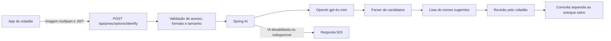

# MediSUS API

API REST para consulta de medicamentos e estoques em Unidades Básicas de Saúde. Este repositório contém o backend Java. O aplicativo React Native não está incluído aqui, portanto a integração com o aplicativo ainda precisa ser feita e testada pela equipe Mobile.

## O que o projeto faz

O backend implementa cadastro e login com JWT, consulta de UBS, medicamentos e estoques, manutenção desses registros por usuários autorizados, alertas de disponibilidade e notificações. Também contém um endpoint que pode analisar uma imagem de receita com Spring AI e OpenAI quando essa integração é configurada. A resposta da análise apresenta nomes candidatos para conferência humana, não um diagnóstico nem uma confirmação de estoque.

O projeto usa Java 17, Spring Boot, Spring Security, Spring Data JPA, PostgreSQL, RabbitMQ, Spring AI, OpenAPI e Maven. Os testes usam H2 e mocks. Não há dados de demonstração incluídos no repositório. O campo de elegibilidade à Farmácia Popular permanece como `UNKNOWN`.

## Material da disciplina

A documentação específica de Disruptive Architectures: IoT, IoB & Generative IA está em [docs/entrega-disruptive-architectures.md](docs/entrega-disruptive-architectures.md). Ela é uma entrega separada do guia técnico de Java Advanced deste README.

## Requisitos

Tenha Java 17 ou superior, Maven 3.9 ou superior e Docker Desktop com Docker Compose instalado. Para executar com Maven, use o Docker para iniciar PostgreSQL e RabbitMQ. A chave OpenAI é opcional e necessária somente para testar a identificação de receita com o provedor real.

## Primeira execução com Docker

1. Clone o repositório e entre na pasta do projeto.

```powershell
git clone https://github.com/Rodrigocsilvaa/MediSUS.git
Set-Location MediSUS
```

2. Crie seu arquivo local de configuração a partir do exemplo.

```powershell
Copy-Item .env.example .env
```

3. Edite `.env` no seu computador. Troque as senhas de exemplo do PostgreSQL e do RabbitMQ e configure um `JWT_SECRET` aleatório com pelo menos 32 caracteres. Não publique o arquivo `.env`, senhas ou tokens no GitHub. Para a análise real de receitas, configure também `OPENAI_API_KEY`, `MEDISUS_AI_ENABLED=true` e `MEDISUS_AI_PROVIDER=openai`. Sem essa configuração, o restante da API pode ser usado normalmente.

4. Inicie os serviços e a API. Na primeira execução, o Docker poderá levar alguns minutos para baixar imagens e compilar o projeto.

```powershell
docker compose up --build
```

5. Quando a inicialização terminar, abra `http://localhost:8080/swagger-ui.html`. A especificação OpenAPI fica em `http://localhost:8080/v3/api-docs`.

Para encerrar, use `Ctrl+C` e depois execute `docker compose down`. Os dados do PostgreSQL ficam no volume do Docker e são mantidos ao parar os serviços.

## Execução local com Maven

Use esta opção para executar a aplicação Java fora do Docker, mantendo PostgreSQL e RabbitMQ em contêineres. O script local carrega as variáveis do arquivo `.env`.

1. Inicie as dependências:

```powershell
docker compose up -d postgres rabbitmq
```

2. Em outro terminal, inicie a API:

```powershell
powershell -ExecutionPolicy Bypass -File .\scripts\run-local.ps1
```

3. Acesse Swagger em `http://localhost:8080/swagger-ui.html`. Para parar os serviços de banco e mensageria, execute `docker compose stop postgres rabbitmq`.

## Criar o primeiro gestor

O cadastro público cria somente contas com papel `CITIZEN`. Para cadastrar UBS, medicamentos e estoques, inicie a API com `BOOTSTRAP_MANAGER_EMAIL` e `BOOTSTRAP_MANAGER_PASSWORD` configurados no `.env`. A senha do gestor deve ter entre 12 e 72 caracteres. O gestor inicial é criado quando a API inicia, caso o e-mail ainda não exista. Depois, use essas credenciais no endpoint de login.

Não há usuários, UBS, medicamentos ou estoques de demonstração pré cadastrados. Use o gestor para criar dados de teste. A senha e o e-mail do gestor são credenciais privadas e devem ser enviados ao colega somente por um canal seguro, quando necessário.

## Testar a API pelo Swagger

1. Abra `http://localhost:8080/swagger-ui.html`.
2. Expanda `POST /api/auth/register`, escolha `Try it out` e envie um cadastro de teste. O cadastro responde `201` e cria um cidadão.

```json
{
  "name": "Pessoa de Teste",
  "email": "teste@example.com",
  "password": "senha-local-com-8-caracteres"
}
```

Use esses dados somente em uma instalação local de teste. A senha precisa ter pelo menos 8 caracteres.

3. Expanda `POST /api/auth/login` e envie o mesmo e-mail e senha. Copie o valor de `token` da resposta.
4. Clique em `Authorize` no topo do Swagger e informe o token. O Swagger aplica o esquema Bearer nas chamadas protegidas.
5. Teste `GET /api/ubs`, `GET /api/medications` ou `GET /api/stocks`. Sem dados cadastrados, uma lista vazia é um resultado normal.
6. Para criar dados, entre com a conta de gestor inicial, autorize o Swagger novamente e use as rotas de UBS, medicamentos e estoque descritas abaixo.

Em clientes HTTP fora do Swagger, envie `Authorization: Bearer SEU_TOKEN`. O token expira após o período de `JWT_EXPIRATION_SECONDS`, que por padrão é 3600 segundos. Não há refresh token; faça login novamente após a expiração.

## Rotas disponíveis

Cadastro, login, Swagger e OpenAPI são públicos. Todas as demais rotas exigem autenticação. As operações de leitura de UBS, medicamentos e estoques podem ser usadas por qualquer usuário autenticado. As operações de escrita desses recursos exigem papel `PHARMACIST` ou `MANAGER`.

### Autenticação

`POST /api/auth/register` cadastra um cidadão.

`POST /api/auth/login` autentica a conta e retorna um JWT.

### UBS

`GET /api/ubs` lista UBS. `GET /api/ubs/{id}` consulta uma UBS.

`POST /api/ubs` cria uma UBS. `PUT /api/ubs/{id}` atualiza uma UBS. `DELETE /api/ubs/{id}` remove uma UBS. As três operações exigem `PHARMACIST` ou `MANAGER`.

Exemplo de corpo para criar ou atualizar:

```json
{
  "name": "UBS Central",
  "address": "Rua de Exemplo, 10",
  "city": "São Paulo",
  "state": "SP",
  "latitude": -23.55,
  "longitude": -46.63
}
```

### Medicamentos

`GET /api/medications` lista medicamentos. `GET /api/medications/{id}` consulta um medicamento.

`POST /api/medications` cria um medicamento. `PUT /api/medications/{id}` atualiza um medicamento. `DELETE /api/medications/{id}` remove um medicamento. As três operações exigem `PHARMACIST` ou `MANAGER`.

```json
{
  "name": "Paracetamol 500 mg",
  "activeIngredient": "paracetamol",
  "description": "Comprimido"
}
```

### Estoques

`GET /api/stocks` lista estoques disponíveis. `GET /api/stocks/{id}` consulta um estoque. A listagem aceita `medicationId`, `ubsId`, `medicationName`, `page`, `size` e `sort`. Exemplos: `GET /api/stocks?medicationId=1&ubsId=1&page=0&size=20` e `GET /api/stocks?medicationName=Paracetamol&page=0&size=20`. Registros com quantidade zero não aparecem na listagem.

`POST /api/stocks` cria ou atualiza o estoque da combinação de UBS e medicamento. `PUT /api/stocks/{id}` atualiza um registro existente. `DELETE /api/stocks/{id}` remove um estoque. As três operações exigem `PHARMACIST` ou `MANAGER`.

```json
{
  "ubsId": 1,
  "medicationId": 1,
  "quantity": 30
}
```

Ao aumentar a quantidade, a API publica um evento no RabbitMQ. O consumidor pode criar notificações para cidadãos com alertas compatíveis. O processamento é assíncrono, então a notificação pode não aparecer imediatamente.

### Alertas e notificações

As rotas de alerta exigem papel `CITIZEN`.

`POST /api/alerts` cria um alerta. `GET /api/alerts` lista os alertas da conta autenticada. `DELETE /api/alerts/{id}` desativa um alerta pertencente à conta.

```json
{
  "medicationId": 1,
  "ubsId": 1
}
```

`ubsId` é opcional. Se não for informado, o alerta vale para qualquer UBS.

`GET /api/notifications` lista as notificações da conta autenticada. `PATCH /api/notifications/{id}/read` marca como lida uma notificação pertencente à conta autenticada.

### Usuários

As duas rotas exigem papel `MANAGER`.

`GET /api/users` lista usuários.

`PUT /api/users/{id}/role` altera o papel de um usuário. Os valores aceitos são `CITIZEN`, `PHARMACIST` e `MANAGER`.

```json
{
  "role": "PHARMACIST"
}
```

### Identificação de receita

`POST /api/prescriptions/identify` exige papel `CITIZEN` e recebe um campo de formulário chamado `image`. Aceita JPEG, PNG ou WebP, com limite de 5 MB. A imagem é processada em memória e não é salva pelo backend. A análise real exige chave OpenAI e configuração do Spring AI. Sem o provedor habilitado, a resposta é `503 Service Unavailable`. O resultado deve ser revisado pela pessoa usuária e não representa diagnóstico ou disponibilidade de estoque.

No aplicativo React Native, envie a imagem como `multipart/form-data` e não defina manualmente o cabeçalho `Content-Type`, para que o `fetch` crie o boundary corretamente.

## Entrega de Disruptive Architectures: IA generativa e visão computacional

### Problema e benefício para o cidadão

Uma pessoa pode ter dificuldade para ler o nome de um medicamento escrito em uma receita. O MediSUS permite que um cidadão autenticado envie uma imagem e receba nomes de medicamentos que o modelo considera legíveis. A pessoa deve conferir as sugestões e só então consultar o estoque. A IA não confirma disponibilidade, não recomenda tratamento e não substitui orientação profissional.

### Técnica escolhida e justificativa

O aprofundamento escolhido é visão computacional com um modelo generativo multimodal pré treinado. O código integra Spring AI ao provedor OpenAI e usa `gpt-4o-mini` por padrão, configurável pela variável `OPENAI_MODEL`. A abordagem foi escolhida porque recebe a imagem diretamente e pode interpretar receitas com layouts diferentes sem treinar um modelo próprio. O projeto não implementa RAG, não treina um modelo de Machine Learning e não compara provedores ou modelos.

O modelo recebe uma instrução para retornar somente nomes e dosagens claramente legíveis em um array JSON, sem diagnosticar, recomendar tratamentos, completar texto ilegível ou afirmar disponibilidade. O backend interpreta a resposta, mantém somente textos não vazios de até 160 caracteres e remove candidatos repetidos.

### Fontes de dados e privacidade

Não foi usado conjunto de dados externo ou de treinamento. A entrada é a imagem enviada pelo próprio usuário ao endpoint `POST /api/prescriptions/identify`. Quando a integração com OpenAI está habilitada, o backend encaminha os bytes da imagem ao provedor para inferência. O backend não grava a imagem em seu banco de dados, mas o envio a um serviço externo deve ser informado à pessoa usuária. Não envie receitas reais ou dados pessoais em testes ou evidências públicas. A chave de acesso ao provedor é privada e deve existir somente no ambiente local ou em um gerenciador de segredos.

### Fluxo da arquitetura



### Evidências de avaliação

Os testes automatizados podem ser reproduzidos na raiz do projeto com `mvn test`. No ambiente desta entrega, a suíte terminou com 7 testes executados, 0 falhas e 0 erros. Os resultados de IA abaixo vêm de testes unitários com um modelo simulado, não de uma chamada real ao OpenAI.

1. `PrescriptionServiceTest.returnsOnlyDistinctTextCandidatesFromTheMockedModel`: o modelo simulado retorna um nome repetido, um número e um texto vazio. Resultado esperado e observado: somente `Paracetamol 500 mg`, uma vez. O teste também verifica a instrução para revisar o resultado.
2. `PrescriptionServiceTest.reportsUnavailableWhenAiIsDisabled`: com a IA desabilitada, o serviço sinaliza indisponibilidade e não consulta o modelo. O teste passou.
3. `StockServiceTest.replenishmentPublishesAnEventWithInventoryIdentifiersAndNames`: aumento de estoque publica o evento esperado usando mocks. Isso valida a regra unitária, mas não comprova comunicação com um RabbitMQ real.
4. `StockServiceTest.rabbitConsumerNotifiesOnlyAlertsMatchingTheReplenishedUbs`: o consumidor simulado cria notificações para alertas da UBS correspondente ou de qualquer UBS, sem notificar um alerta de outra unidade. O teste passou.

Os critérios implementados e cobertos pelos testes são retornar somente candidatos textuais válidos, remover duplicatas, instruir revisão humana e não chamar o modelo quando a funcionalidade está desabilitada. O projeto não mediu taxa de acerto, precisão, recall, latência ou custo do modelo. Não existe resultado quantitativo de qualidade da leitura e não se deve interpretar os testes simulados como prova da precisão do OpenAI.

Antes de apresentar uma avaliação ao vivo, execute testes manuais com uma imagem legível, uma imagem ilegível, uma imagem vazia, um formato não aceito e a IA desabilitada. Registre para cada cenário a entrada de teste sem dados pessoais, o status HTTP e a resposta observada. Esses cenários manuais ainda não foram validados como chamadas reais nesta entrega. Capturas do Swagger podem complementar o registro, mas não são obrigatórias nem substituem os casos, resultados e limitações descritos aqui. Nunca publique receitas reais, chaves, senhas ou tokens nas capturas.

### Limitações e relação com IoT e IoB

A saída pode omitir ou interpretar incorretamente um medicamento, especialmente em imagens borradas, manuscritas ou com baixa resolução. O backend não compara as sugestões com um catálogo oficial e não confirma se o medicamento existe ou está disponível. O provedor real não foi exercitado pelos testes automatizados; a funcionalidade depende de chave válida, rede e disponibilidade do serviço externo. O endpoint valida o MIME informado, mas não verifica os bytes reais do arquivo.

O código atual não conecta sensores, dispositivos IoT, dados biométricos ou fontes de IoB. RabbitMQ é usado para comunicação assíncrona entre componentes do backend; isso, por si só, não é uma integração IoT. Como evolução possível, sensores de temperatura em câmaras de armazenamento poderiam enviar leituras para alertar sobre condições inadequadas de conservação, mas essa funcionalidade não foi implementada nem avaliada neste projeto.

### Onde conferir no código

O endpoint e as validações de imagem estão em `src/main/java/br/com/medisus/api/api/PrescriptionController.java`. A integração com o provedor está em `src/main/java/br/com/medisus/api/ai/AiConfiguration.java`. A filtragem e o tratamento de indisponibilidade estão em `src/main/java/br/com/medisus/api/ai/PrescriptionService.java`. Os parâmetros de modelo estão em `src/main/resources/application.yml`. Os testes unitários de IA estão em `src/test/java/br/com/medisus/api/ai/PrescriptionServiceTest.java`.

## Conectar um aplicativo ou outro computador

A URL depende de onde o aplicativo está sendo executado.

1. Emulador Android padrão do Android Studio: use `http://10.0.2.2:8080`.
2. Simulador iOS executado no mesmo Mac da API: use `http://localhost:8080`.
3. Celular físico na mesma rede Wi Fi do computador: use `http://IP-DA-MAQUINA:8080`. Descubra o endereço local do computador com `ipconfig` no Windows. O firewall precisa permitir a conexão na porta 8080.
4. Colega em outra rede: `localhost` e o IP local não funcionarão. A API precisa estar implantada em um servidor acessível, com HTTPS, ou em um ambiente de túnel autorizado. Não exponha diretamente uma máquina de desenvolvimento à internet.

O cliente deve guardar o JWT em armazenamento seguro da plataforma, enviar o token nas rotas protegidas e tratar `401` como sessão inválida e `403` como falta de permissão. Mobile nativo não depende de CORS. Expo Web pode exigir uma configuração CORS no backend, que ainda não está definida neste projeto.

## O que enviar ao seu colega para testar

Envie por mensagem os itens abaixo, preenchendo os campos com os dados do ambiente de teste. Não coloque senha, token ou endereço privado no README ou em uma issue pública.

```text
API base URL: [URL acessível para o seu colega]
Swagger: [URL base]/swagger-ui.html
Cadastro: POST [URL base]/api/auth/register
Login: POST [URL base]/api/auth/login
Conta de teste: use o cadastro de cidadão ou receba uma conta de teste por canal seguro
Token: faça login e envie Authorization: Bearer [token]
Primeira chamada: GET [URL base]/api/ubs?page=0&size=20
```

Se o colega precisar testar cadastro de UBS, medicamentos ou estoques, ele também precisará de uma conta `PHARMACIST` ou `MANAGER` e de IDs existentes para relacionar UBS, medicamento e estoque. Para testar alertas, use uma conta `CITIZEN`. Combine o endereço base correto para o dispositivo ou computador do colega antes do teste. Um endereço `localhost` acessível na sua máquina não é automaticamente acessível na máquina dele.

## Respostas e erros

As listagens são paginadas. Os parâmetros `page` começam em zero e `size` define a quantidade por página. Uma resposta contém campos como `content`, `totalElements`, `totalPages`, `size` e `number`.

Erros usam JSON com horário, status HTTP, mensagem, caminho e erros de campos quando aplicável. Os códigos mais comuns são `400` para dados inválidos, `401` para ausência ou invalidade do token, `403` para falta de papel, `404` para recurso inexistente, `409` para conflito, como e-mail já cadastrado, e `503` quando a análise de receita não está disponível.

## Testes automatizados

Execute a partir da pasta do projeto:

```powershell
mvn test
```

Os testes automatizados verificam regras de serviço, segurança e validação, filtro de estoques, publicação e seleção de eventos com mocks, além do comportamento da funcionalidade de IA com modelo simulado. Eles não comprovam conexão com PostgreSQL ou RabbitMQ reais, chamada real à OpenAI, nem integração com um aplicativo Mobile.

## Segurança e limitações

Nunca envie `.env`, senhas, tokens JWT, chaves de serviço, RMs ou outros dados pessoais ao GitHub. Use credenciais específicas para teste e compartilhe somente com as pessoas que precisam delas, por um canal privado.

O projeto não tem implantação pública configurada, não possui token de renovação e não inclui aplicativo Mobile. A elegibilidade à Farmácia Popular é sempre `UNKNOWN`. O endpoint de receita valida o tipo MIME informado, mas não confirma o conteúdo binário real do arquivo.

## Equipe

Projeto desenvolvido para a disciplina Java Advanced, turma 2TDSR. A identificação individual da equipe deve ficar somente nos materiais privados de entrega, não neste README público.
