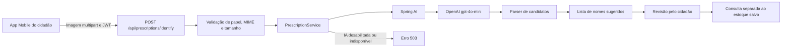

# MediSUS na disciplina Disruptive Architectures

## Identificação da entrega

Esta é a documentação da solução MediSUS para a disciplina Disruptive Architectures: IoT, IoB & Generative IA. Ela é uma entrega separada de Java Advanced. O enunciado fornecido define como requisito central uma funcionalidade de IA generativa integrada à CitizenTech, com aprofundamento técnico, arquitetura documentada, avaliação e limitações.

O foco implementado pelo MediSUS nesta disciplina é IA generativa aplicada à leitura assistida de receitas. O código atual não contém integração com sensores físicos IoT nem coleta de dados IoB. Esses pontos são explicitados para não apresentar como implementada uma tecnologia que ainda não existe no projeto.

## Problema e público beneficiado

Uma pessoa pode ter dificuldade para identificar o nome de um medicamento escrito em uma receita. O MediSUS oferece ao cidadão autenticado um endpoint que recebe uma imagem e sugere nomes de medicamentos que o modelo considera legíveis. O cidadão confere a sugestão e pode pesquisar separadamente a disponibilidade registrada nas UBS.

A funcionalidade reduz uma dificuldade de leitura, mas não substitui farmacêuticos, médicos ou outras fontes oficiais. A IA não diagnostica, não recomenda tratamentos e não confirma a existência ou disponibilidade do medicamento.

## Funcionalidade e tecnologia escolhida

O endpoint `POST /api/prescriptions/identify` aceita uma imagem JPEG, PNG ou WebP de até 5 MB. O campo do formulário multipart chama-se `image` e a chamada requer autenticação com o papel `CITIZEN`.

O backend usa Spring AI para enviar a imagem a um modelo multimodal da OpenAI. O modelo configurado por padrão é `gpt-4o-mini`, selecionado por `OPENAI_MODEL`. A configuração de desenvolvimento mantém a funcionalidade desabilitada por padrão. Para habilitá-la é necessário configurar `MEDISUS_AI_ENABLED=true`, `MEDISUS_AI_PROVIDER=openai` e uma chave privada em `OPENAI_API_KEY`.

O modelo recebe uma instrução para retornar um array JSON contendo somente nomes e dosagens claramente legíveis. O serviço interpreta esse resultado, remove entradas não textuais, vazias ou repetidas e limita o tamanho de cada candidato a 160 caracteres. A resposta também orienta o cidadão a revisar os nomes antes de consultar o estoque.

### Justificativa técnica

Foi escolhido um modelo multimodal pré treinado porque a entrada da funcionalidade é uma imagem de receita e o projeto não possui um conjunto de imagens rotuladas para treinar e avaliar um modelo próprio. A integração via Spring AI permite manter o acesso ao modelo atrás de um serviço do backend, sem expor a chave do provedor ao aplicativo Mobile.

O aprofundamento técnico desta entrega é visão computacional com IA generativa. O projeto não implementa RAG, não treina modelos de Machine Learning e não compara quantitativamente diferentes modelos ou provedores.

## Dados, origem e privacidade

O projeto não usa um conjunto de dados externo ou de treinamento. A entrada é a imagem fornecida pelo próprio usuário na chamada do endpoint. O backend processa os bytes em memória e não persiste a imagem no banco de dados. Quando a integração está habilitada, o backend encaminha a imagem à OpenAI para inferência. O tratamento posterior pelo serviço externo está sujeito às condições desse provedor.

Não devem ser usadas receitas reais ou dados pessoais nas demonstrações públicas. Para testes manuais, prefira uma imagem sintética, sem nome, número de documento, endereço ou outras informações identificáveis. A chave da OpenAI deve ser configurada apenas no ambiente local ou em um gerenciador de segredos, nunca no GitHub, em capturas de tela ou no aplicativo Mobile.

## Arquitetura e fluxo



O aplicativo não recebe nem usa diretamente a chave da OpenAI. A imagem chega ao backend, que verifica a autenticação, o tipo MIME declarado e o tamanho máximo configurado. O serviço chama o modelo somente quando a funcionalidade está habilitada e há um modelo disponível. A lista de candidatos é retornada para revisão humana. A busca de estoque ocorre em uma chamada separada da API.

## Como reproduzir

As instruções de instalação, configuração de `.env`, inicialização com Docker Compose, cadastro e autenticação estão no [README do projeto](../README.md). A documentação interativa da API fica em `http://localhost:8080/swagger-ui.html` quando os serviços estão ativos.

Para experimentar a funcionalidade com o provedor real, configure as variáveis de IA no `.env` local, inicie o PostgreSQL, o RabbitMQ e a API, crie ou use uma conta `CITIZEN`, autorize a chamada no Swagger e envie uma imagem de teste no campo `image`. Não registre ou publique a chave, o token nem a imagem enviada.

Os testes automatizados podem ser reproduzidos com:

```powershell
mvn test
```

## Evidências de avaliação

Na execução registrada para esta entrega, a suíte Maven concluiu com 7 testes, 0 falhas e 0 erros. Os testes de IA usam um modelo simulado, portanto o resultado comprova regras do serviço e não a precisão de uma chamada real à OpenAI.

### Casos automatizados e resultados

1. `PrescriptionServiceTest.returnsOnlyDistinctTextCandidatesFromTheMockedModel` fornece ao modelo simulado um nome repetido, um valor numérico e uma string vazia. O serviço retorna somente `Paracetamol 500 mg`, uma vez, e fornece a orientação para revisar o resultado. Resultado: passou.
2. `PrescriptionServiceTest.reportsUnavailableWhenAiIsDisabled` executa o serviço com IA desabilitada. O serviço sinaliza indisponibilidade e não consulta o modelo. Resultado: passou.

Esses casos foram executados pelo comando `mvn test` dentro da imagem Maven do Docker. A suíte também inclui testes de segurança, validação, estoque e eventos RabbitMQ com mocks. Não houve execução de uma chamada real à OpenAI, de uma integração real com RabbitMQ ou PostgreSQL, nem do aplicativo Mobile contra a API.

### Critérios adotados

O teste automatizado verifica se o serviço mantém apenas nomes textuais não vazios, remove duplicatas e informa ao cidadão que precisa revisar a sugestão. Também verifica o comportamento seguro quando a IA está desabilitada. No endpoint, são aceitos os MIME `image/jpeg`, `image/png` e `image/webp`, e o tamanho total da imagem é limitado a 5 MB.

O projeto não mediu acurácia, precisão, recall, taxa de leitura correta, latência ou custo do modelo. Não existe base rotulada que permita afirmar quantitativamente a qualidade do reconhecimento. Não se devem inventar percentuais ou apresentar os testes simulados como evidência de precisão clínica.

### Casos manuais recomendados, ainda não executados

1. Enviar uma imagem sintética e legível com o provedor habilitado; registrar status HTTP, resposta recebida e conferência humana dos nomes.
2. Enviar uma imagem sintética ilegível ou sem texto; verificar se o resultado não apresenta uma sugestão indevida e registrar a resposta efetiva.
3. Enviar imagem vazia e arquivo com MIME não aceito; verificar a rejeição pelo endpoint.
4. Repetir a chamada com a funcionalidade desabilitada; verificar a resposta de indisponibilidade.
5. Testar uma requisição sem JWT ou com papel diferente de `CITIZEN`; registrar o comportamento de autorização.

Esses itens são um protocolo para completar a avaliação, não resultados já obtidos. Para cada execução manual, registrar a data, a configuração sem revelar segredos, o cenário, o status HTTP e uma resposta anonimizada. Capturas do Swagger podem complementar a evidência, mas o enunciado pede casos, resultados, critérios e limitações, não apenas prints. Não publique imagens de receitas pessoais, tokens ou chaves.

## Relação com IoT e IoB

O repositório atual não conecta sensores, dispositivos IoT, dados biométricos ou fontes de IoB. RabbitMQ transporta eventos entre componentes do backend e, isoladamente, não constitui uma implementação IoT.

Uma evolução possível do MediSUS seria monitorar a temperatura de equipamentos de armazenamento de medicamentos com sensores instalados nas UBS. Um dispositivo autorizado poderia enviar identificador, unidade, horário e leitura ao backend; o sistema poderia registrar a série temporal e gerar um alerta quando a leitura ultrapassasse limites definidos por fonte técnica oficial para o medicamento armazenado. Essa evolução precisaria de hardware, protocolo de comunicação, critérios oficiais de temperatura, persistência de medições e testes de conectividade. Nada disso está implementado ou avaliado neste repositório.

## Limitações e uso responsável

1. O modelo pode omitir nomes ou confundir medicamentos, concentrações e grafias, especialmente em receitas manuscritas, borradas ou com baixa resolução.
2. A resposta não é verificada contra catálogo oficial de medicamentos nem contra os estoques antes de ser mostrada ao cidadão.
3. O teste automatizado substitui o modelo por um mock e não mede a qualidade da inferência real.
4. A chamada real depende de chave válida, rede, disponibilidade e condições do provedor externo. O projeto não demonstra como esse provedor retém ou trata uma imagem após recebê-la.
5. O endpoint valida o MIME declarado, mas não confere se os bytes da imagem correspondem ao formato informado.
6. A elegibilidade à Farmácia Popular permanece `UNKNOWN`; a IA não pode determiná-la.
7. Não há integração com dispositivos IoT ou dados de IoB neste repositório.

## Arquivos para conferência

`src/main/java/br/com/medisus/api/api/PrescriptionController.java` contém o endpoint e as validações da requisição.

`src/main/java/br/com/medisus/api/ai/AiConfiguration.java` contém a chamada ao modelo generativo com imagem.

`src/main/java/br/com/medisus/api/ai/PrescriptionService.java` contém a disponibilidade, filtragem e interpretação dos candidatos.

`src/main/resources/application.yml` contém as configurações padrão do provedor e do limite de upload.

`src/test/java/br/com/medisus/api/ai/PrescriptionServiceTest.java` contém os dois testes unitários de IA descritos acima.

## Material de identificação para a submissão

O enunciado pede um arquivo `.txt` separado com o RM e o nome completo de cada integrante, além do link do GitHub. Os RMs não foram incluídos neste documento nem devem ser publicados no repositório. A equipe deve preencher esse arquivo de identificação com os dados oficiais antes de enviar a submissão pelo portal.
